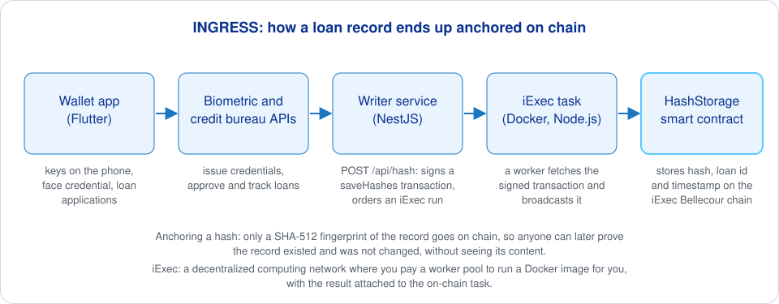

# INGRESS hash storage contract

The Solidity smart contract that keeps the on-chain record of INGRESS loan histories. INGRESS is an Iriscan project from the EU NGI ONTOCHAIN program: biometric credentials and verifiable credit histories for microlending. The contract stores nothing personal, only a hash of each loan record together with the loan ID and a timestamp, so that a lender can later prove a record existed and was not changed. It is one file, `hashes_saver.sol`, contract `HashStorage`.

Anchoring a hash means writing only a fingerprint of a record (here SHA-512) to the chain: anyone can later check that a record existed at a given time and was not altered, while the record itself stays private. iExec is a decentralized computing network: you pay a worker pool to run a Docker image for you, and the result is tied to an on-chain task.

## What it does

- `saveHashes(HashStruct[])`: owner-only. Stores each `{ hash, timestamp, loanId }` in a mapping keyed by the hash and emits a `NewHash` event with the whole batch. A hash that is already stored makes the call revert with "Hash already exist.", so a record cannot be re-anchored with a different timestamp.
- `getHashInfo(hash)`: public view. Returns the stored struct, or reverts with "Hash does not exist." The writer service calls this before pushing to skip hashes that are already on chain.
- `owner()` and `transferOwnership(newOwner)`: a minimal ownable pattern; transferring to the zero address reverts with `OwnableInvalidOwner`.

A note for readers of the source: the private helper `isExist` returns `true` when the hash is not stored (its timestamp is zero), so the `require` checks read inverted from their names. The behavior described above is what the contract does.

## How to deploy

The contract has no build tooling in this repository. Compile `hashes_saver.sol` with any Solidity 0.8.x compiler (Remix, Hardhat or Foundry) and deploy it from the wallet that will act as owner. INGRESS runs it on the iExec Bellecour sidechain (`https://bellecour.iex.ec`), and the deployed address goes into the writer's `HASH_SAVER_CONTRACT_ADDRESS`. The same wallet's private key goes into the writer's `CONTRACT_OWNER_PRIVATE_KEY`, because only the owner can call `saveHashes`.

## Related repositories

- [ontochain-iexec-writer](https://github.com/biometric-technologies/ontochain-iexec-writer): the NestJS service that signs `saveHashes` transactions.
- [ontochain-iexec-task](https://github.com/biometric-technologies/ontochain-iexec-task): the iExec task that broadcasts them.
- [ontochain-digital-wallet](https://github.com/biometric-technologies/ontochain-digital-wallet): the Flutter wallet users apply for loans with.
- [ingress-site](https://github.com/biometric-technologies/ingress-site): project website with user guides.

## License

License: not yet specified (there is no LICENSE file). The source file carries an `SPDX-License-Identifier: MIT` header.

## Contact

info@iriscan.net, https://www.iriscan.com
